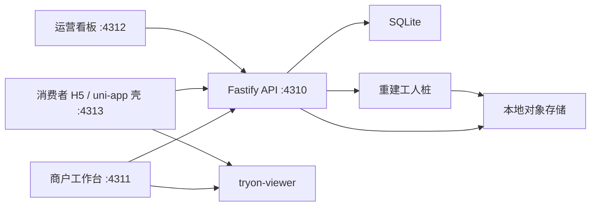

# 绫境

电商三维虚拟试衣的可运行骨架。商户上传商品和多角度照片，系统排队做一次**占位**三维重建；消费者按身材档案叠穿上装和下装；运营看板看上传、队列和试穿漏斗。

这不是生产系统。摄影测量、SMPL-X、登录、支付和原生 App 打包都留了接口，没有接真实服务，也没有任何密钥。

正式开发以本仓库为准。交互体验可以先用本机 HTML 原型点一点；接接口、改三端、做团队协作，都从这里克隆。

团队主仓：<https://github.com/Adiiksubaby/lingjing-tryon>

## 已知限制

- 没有真实支付。加入购物车只记一条转化，没有订单和库存。
- 没有摄影测量，也没有 SMPL / SMPL-X。人台是参数化几何。
- 人脸只存照片，留给以后贴到人模上。本期不识别、不贴模。

更完整的边界在文末「MVP 里明确没做」。

## 克隆并启动

需要 **Node.js ≥ 22.5**。API 使用内置 `node:sqlite`，`package.json` 的 `engines.node` 是 `>=22.5`。包管理用 **pnpm 9**，请用 npm 安装，不要执行 `corepack enable`。

```bash
git clone https://github.com/Adiiksubaby/lingjing-tryon.git
cd lingjing-tryon
node -v
npm i -g pnpm@9
pnpm install
pnpm dev
```

`pnpm dev` 同时拉起四个进程，端口是 **4310–4313**：

| 端 | 地址 | 进来看什么 |
| --- | --- | --- |
| API | http://127.0.0.1:4310 | 健康检查 `/api/health` |
| 商户工作台 | http://127.0.0.1:4311 | 建 SKU、队列、预览样衣 |
| 运营看板 | http://127.0.0.1:4312 | 上传、队列、试穿漏斗 |
| 消费者 | http://127.0.0.1:4313 | 底部三个 Tab：商城、试衣间、我的 |

也可以分开跑：`pnpm dev:api`、`pnpm dev:merchant`、`pnpm dev:ops`、`pnpm dev:consumer`。只起 API 用 `pnpm start:api`（`apps/api` 的 `start` 用 `tsx` 直接跑源码）。

其他命令：

```bash
pnpm test       # 网格 / GLB / API
pnpm typecheck
pnpm build      # 前端 vite build，API 只做类型检查
```

第一次启动 API 会在仓库根目录创建 `data/`：SQLite 库和本地文件。这个目录已忽略，不要提交。想回到种子数据，停掉 API，删掉 `data/`，再启动。

可选配置见根目录 `.env.example`。不复制也能跑。演示令牌：

| 角色 | 令牌 | 名字 |
| --- | --- | --- |
| 商户 | `demo-merchant` | 杭州绫境服饰 |
| 消费者 | `demo-consumer` | 林夏 |
| 运营 | `demo-ops` | 绫境运营 |

三个前端启动时会自己换演示令牌，不用手填。

克隆暂时没有权限时，可以用同一份干净源码包 `lingjing-tryon-src.zip`：里面没有 `node_modules`、`data/`、`dist/`、`.turbo`，也没有 `.git`。解压后进入该目录，再执行 `pnpm install` 和 `pnpm dev`。

### Windows

用 PowerShell：

```powershell
node -v
npm i -g pnpm@9
corepack disable
```

把 npm 的全局目录放在 PATH **最前面**，这样会先找到 `pnpm.cmd`，而不是 corepack：

```powershell
[Environment]::SetEnvironmentVariable(
  'Path',
  "$env:APPDATA\npm;" + [Environment]::GetEnvironmentVariable('Path', 'User'),
  'User'
)
```

关掉终端再开一个，执行 `pnpm -v`，应类似 `9.x`。再用 `where.exe pnpm` 确认第一条是 `%APPDATA%\npm\pnpm.cmd`。如果仍走到 corepack，把那条路径从 PATH 里挪到 `%APPDATA%\npm` 后面，或直接删掉。

### macOS / Linux

上面的 `npm i -g pnpm@9` 同样适用。不要执行 `corepack enable`。

## 架构



| 目录 | 作用 |
| --- | --- |
| `apps/api` | Fastify API、SQLite、本地/S3 存储抽象、重建工人 |
| `apps/merchant-web` | 商户：建 SKU、看队列、预览样衣 |
| `apps/ops-web` | 运营：成功率、队列、会话、加购漏斗 |
| `apps/consumer-uniapp` | 消费者。目录按 uni-app（`pages.json`、`manifest.json`、pages、stores），当前用 Vite 跑 H5 |
| `packages/shared` | Zod 模型、中文文案、DTO |
| `packages/tryon-viewer` | Three.js 人台、占位服装网格、GLB 编码、双件叠穿 |

## 建议走一遍

1. 打开消费者端，底部有三个板块：**商城**、**试衣间**、**我的**。商城顶部是「杭州绫境服饰」和公告。左侧是上装、裤装、裙装。上装里有云白圆领短袖和亚麻宽松衬衫。滑到分类交界时会顿一下，再滑才进入下一类；点左侧分类会直接跳到那一段。点「加入试衣间」只记进清单，不结算。
2. 打开试衣间。林夏和周予都可以选。周予已经有一张照片，会看到「已上传，后续将识别并贴到人模」——这一期没有做人脸识别，也没有贴到人模上。清单里同一部位再选一件，会换掉身上那件；上装和下装可以叠在一起。展开「调整身材」，人台会马上变。点「加入购物车」只记一条转化。
3. 打开「我的」。可以新建人员，填写头像、自己的照片、生日、年龄、性别、手机号和身材尺寸，保存后试衣间的选人列表里会出现。
4. 商户台的「店铺」可以改店名、公告和分类。商品详情里可以把样衣归到某个分类。新建商品时选好正面、侧面、背面（JPG / PNG / WEBP），保存后进入详情，点「发起重建」。时间线会依次走过接收、核对、轮廓、网格、发布，大约几秒。成功后右侧能预览，消费者商城里也能看到。
5. 想看失败：详情里勾选「模拟失败」再发起。生成网格阶段会停下并写出原因。取消勾选后点「重试重建」即可成功。上一件已经发布的样衣不会被这次失败拿掉。

种子商品在启动时就已经发布，所以消费者一打开就有衣服。你新建的商品要在详情里点一次「发起重建」。

## 数据与存储

演示用 **SQLite**（Node 内置 `node:sqlite`）和进程内 `setInterval` 队列，不依赖 Docker、Postgres 或 Redis。单机演示够用。并发和多实例上来之后，再把库换成 Postgres、把 `apps/api/src/worker.ts` 换成 Redis/BullMQ。

对象存储是一个小接口（`put` / `get` / `exists` / `remove`）：

- 默认 `STORAGE_DRIVER=local`，文件在 `data/storage/`。
- `STORAGE_DRIVER=s3` 且配好 `S3_ENDPOINT`、`S3_BUCKET`、`S3_ACCESS_KEY_ID`、`S3_SECRET_ACCESS_KEY` 时走 `@aws-sdk/client-s3`，兼容 MinIO 这类 path-style 服务。仓库里没有密钥。缺配置时 API 会直接拒绝启动，不会假装写成功。

照片和 GLB 的演示地址**不鉴权**，方便 `` 和 GLTFLoader。生产环境要改成短时签名 URL。

## 接口

除了健康检查、演示登录和文件地址，其余都要 `Authorization: Bearer <token>`。

| 方法 | 路径 | 谁可以用 |
| --- | --- | --- |
| GET | `/api/health` | 公开 |
| POST | `/api/auth/demo` | 公开，body `{ "role": "merchant" \| "consumer" \| "ops" }` |
| GET/POST | `/api/skus` | 读：三种角色；创建：商户，`multipart/form-data` |
| GET/PATCH/DELETE | `/api/skus/:id` | 读：已登录；改/删：商户本人 |
| POST | `/api/skus/:id/jobs` | 商户，重新排队 |
| GET | `/api/jobs`、`/api/jobs/:id` | 商户、运营 |
| GET | `/api/assets/:id`、`/api/assets/:id/file` | 元数据要登录；文件公开 |
| GET | `/api/images/:id/file` | 公开 |
| GET/PATCH | `/api/storefront` | 读：已登录；改店名和公告：商户、运营 |
| GET/POST/PATCH/DELETE | `/api/shop-categories` | 读：已登录；增删改：商户、运营 |
| GET/POST/DELETE | `/api/fitting-room` | 消费者自己的试衣间清单 |
| GET/POST/PATCH | `/api/profiles`、`/api/profiles/:id` | 消费者维护自己的人员；运营只读 |
| POST | `/api/profiles/:id/avatar`、`/api/profiles/:id/photo` | 消费者上传头像或个人照片 |
| GET | `/api/profiles/:id/avatar/file`、`/api/profiles/:id/photo/file` | 公开 |
| GET/POST/PATCH | `/api/sessions`、`/api/sessions/:id` | 同上 |
| GET/POST/PATCH/DELETE | `/api/outfits`、`/api/outfits/:id` | 同上，一件上装加一件下装 |
| POST | `/api/events` | 消费者。`browse` / `try_on` / `add_to_cart` |
| GET | `/api/metrics` | 运营 |

创建商品的表单字段：`name`、`category`（`top`/`bottom`）、`priceYuan`、`color`、`sizes`、`description`、`silhouette`、`fit`、`easeCm`、`length`、`fabric`、`notes`，以及可选文件 `image_front`、`image_side`、`image_back`、`image_detail`。照片可以后补：`POST /api/skus/:id/images`，删除单张：`DELETE /api/skus/:id/images/:imageId`。正面、侧面、背面齐了再 `POST /api/skus/:id/jobs`。上装只能是 `tee`/`shirt`，下装只能是 `pants`/`skirt`。消费者列表用 `GET /api/skus?ready=1`，只看已经发布的样衣。

看板里的上传成功率、浏览、试穿、加购、会话数带了一组演示基线。你新产生的 `live` 任务和事件会加在上面，示例数据单独标出来。

## 三维约定

占位服装按**基准人台**建模，不是按某个顾客建模：

- Y 轴向上，单位米，原点在双脚中心。
- 基准尺寸：身高 170，体重 62，肩宽 40，胸围 88，腰围 72，臀围 94，裤内长 78，臂长 56。常量在 `packages/shared` 的 `BASE_MEASUREMENTS`。
- 松量会把衣服壳向外推，并做了上限，避免飘离身体。

人台网格在 `packages/tryon-viewer/src/body.ts`，地标计算在 `layout.ts` 的 `layoutBody()`。查看器挂人台的位置是 `packages/tryon-viewer/src/viewer.ts` 里的 `createBodyObject()`。

### 身材档案怎么驱动人台

消费者档案现在有：身高、体重、肩宽、胸围、腰围、臀围、裤内长、臂长，以及头像、个人照片、生日、年龄、性别、手机号。围度和身高会改人台。照片、生日、年龄、性别和手机号先落库，给人以后生成形象用；照片不会在本期贴到人模上。胸围就是上身围度（bust/chest 共用一个数），没有单独的下胸围。旧库启动时会补新列。林夏和周予的种子档案都在，周予带了一张占位照片。

| 字段 | 人台上看到的变化 |
| --- | --- |
| 身高 | 头顶高度。头和颈按身高比例走 |
| 裤内长 | 裆高。腿变长时躯干变短，反过来也一样 |
| 胸围 / 腰围 / 臀围 | 对应高度的椭圆截面，周长对齐这个数 |
| 肩宽 | 肩峰间距，肩部截面和手臂根一起外扩 |
| 臂长 | 肩峰到手腕的距离，手臂保持轻微 A 字 |
| 体重 | 在围度之外再乘一层厚度，不改身高和四肢长度 |

试衣间里可以展开「调整身材」。滑杆会马上改人台，并在大约 0.3 秒后写回 `PATCH /api/profiles/:id`。「我的」里可以新建人员，并一起改头像、照片、生日、年龄、性别、手机号和这些尺寸。

衣服还是基准码 GLB。`garmentFitScale()` 让上装跟着肩高、胸围和肩宽，下装跟着裆高和臀围，所以围度和腿长变化时衣服还贴在身上。臂长不会单独把袖子拉长，裤长也不是按纸样重裁。

当前不会做布料解算，也不会按臂长重生成袖片。

## 商户上传和重建

商户工作台的路径是：新建商品 → 详情里补齐正面 / 侧面 / 背面（细节图可选）→ 发起重建 → 看阶段进度 → 成功后到消费者端叠穿。

演示工人不会瞬间成功。每个阶段大约 1.4 秒（`JOB_STAGE_MS`），顺序是：

1. 接收素材
2. 核对角度
3. 估计轮廓
4. 生成网格
5. 发布到试穿目录

时间线写在任务的 `logs` 里。详情页能删单张、替换、补传。重建进行中不能改照片。勾选「模拟失败」会在生成网格阶段停下，原因可直接重试。上一件已经发布的样衣不会因为这次失败从试穿目录消失。

照片格式：JPG、PNG、WEBP（种子数据的 SVG 只给示例用）。单张最大 8MB。

## 真实重建怎么接

替换点是 `apps/api/src/reconstruct.ts` 的 `ReconstructionAdapter`。`createReconstructionAdapter()` 现在只认 `RECONSTRUCTION_ADAPTER=stub`（默认）。

```ts
export const myAdapter: ReconstructionAdapter = {
  id: 'vendor-x',
  async reconstruct(input) {
    // input.images 含正面、侧面、背面的字节和 contentType
    // input.params 是版型、松量、衣长、面料
    // 在这里提交外部任务并等到 GLB 返回
    return { glb, meta: { pipeline: 'vendor-x' } };
  },
};
```

阶段推进在 `apps/api/src/worker.ts`。真实服务如果自己有排队，可以让 `reconstruct()` 一直阻塞到结束，或以后改成回调。抛错时任务变成 `failed`，`error` 就是页面上的原因。坐标约定不变：Y 轴向上，单位米，原点在双脚中心，按基准人台建模。

种子商品仍会在启动时直接发布，不等这 1.4 秒。

## 体型服务怎么接

`createBodyObject(measurements)` 现在调用 `buildMannequin()`。这是参数化几何，不是摄影测量，也不是 SMPL。换成 SMPL-X 一类服务时，只替换这个函数：

```ts
const response = await fetch(`${SMPL_X_URL}/mesh`, {
  method: 'POST',
  headers: { 'content-type': 'application/json' },
  body: JSON.stringify(measurements),
});
```

请求体和 `measurementsSchema` 一致：`heightCm`、`weightKg`、`shoulderCm`、`chestCm`、`waistCm`、`hipCm`、`inseamCm`、`armLengthCm`。服务可以忽略它还不用的字段。返回的网格换上人台之后，服装应改成按关节蒙皮或在体表重算，而不是 `garmentFitScale()` 这种整件缩放。档案接口和试衣间滑杆不用改。

## UniApp

`apps/consumer-uniapp/src/pages.json` 和 `manifest.json` 按 uni-app Vue3 放好了，页面在 `src/pages`，状态在 `src/stores`。为了让三维试穿在这个仓库里直接跑起来，开发服务器是 Vite + Vue Router，不是 `@dcloudio/vite-plugin-uni`。H5 模板用的是普通 DOM。Vue 把 `view`、`text`、`image` 当成保留标签，不能再注册成组件，所以没有硬套 uni 标签。迁回 uni 编译器时，把这些 `div` / `span` / `img` 换回 `view` / `text` / `image` 即可。

原生打包时：

1. 用 HBuilderX 或 `@dcloudio/vite-plugin-uni` 编这份 `pages.json`。
2. 构建一个可访问的 H5 试衣页。
3. 设 `VITE_UNI_NATIVE_WEBVIEW=1`。`pages/tryon/tryon.vue` 会改成 `<web-view>`，打开 `/tryon?host=webview&top=...&bottom=...`。
4. App 里不要指望在 nvue 里直接跑这份 Three.js。WebGL 放在 WebView 里更稳。

## MVP 里明确没做

- 不做摄影测量，不做真实布料，不做 SMPL / SMPL-X。
- 不做真实人脸识别，也不把照片贴到人模上。个人照片只存档，界面写明后续再识别并贴模。
- 登录是固定演示令牌，没有注册、没有店铺隔离以外的认真鉴权。
- 加入购物车只写一条漏斗事件，没有订单、库存和支付。
- 文件 URL 公开，CORS 对本地调试放开。
- 数据库没有正式迁移工具。臂长这一列会在启动时补上；其它改表仍建议删除 `data/` 重启。
- 队列在 API 进程里。进程退出时，正在跑的那一下会丢，重启后仍是 `running` 的任务会在延迟满足后继续写 GLB。
- 消费者端不是打好的 apk / ipa，只是 uni-app 形态的 H5 壳。

## 下一步

1. 用真实重建替换 `reconstructGarment()`，输出仍遵守上面的坐标系。
2. 用 SMPL-X 或自研体型服务替换 `createBodyObject()`，服装改蒙皮。
3. 把 uni-app 打成 App，试衣页走 WebView。
4. 换掉演示令牌：商户账号、消费者登录、文件签名 URL。
5. 在 `add_to_cart` 后面接购物车和支付。不要把支付密钥放进仓库。
6. 需要多实例时，再上 Postgres、Redis 和 S3。

## 常见问题

**页面提示连不上 API。** 先看 4310 是否在听。`pnpm dev` 四个进程一起起，API 稍晚几秒也可以，刷新即可。

**改了表结构或种子看起来旧。** 停掉 API，删除 `data/`，再启动。

**SQLite 实验特性警告。** Node 的 `node:sqlite` 仍标记为实验。`pnpm dev` 会尽量关掉这条警告。若终端仍打出 ExperimentalWarning，可以忽略，API 能正常听 4310。

**`pnpm` 报 corepack 或 access token。** 执行 `corepack disable`，再 `npm i -g pnpm@9`。Windows 要把 `%APPDATA%\npm` 放在 PATH 最前面，新开终端后用 `where.exe pnpm` 确认。不要用 `corepack prepare`。

**端口被占用。** 四个端口是 4310–4313，改 API 的 `PORT` 时记得同步改三个 Vite 配置里的 proxy。
